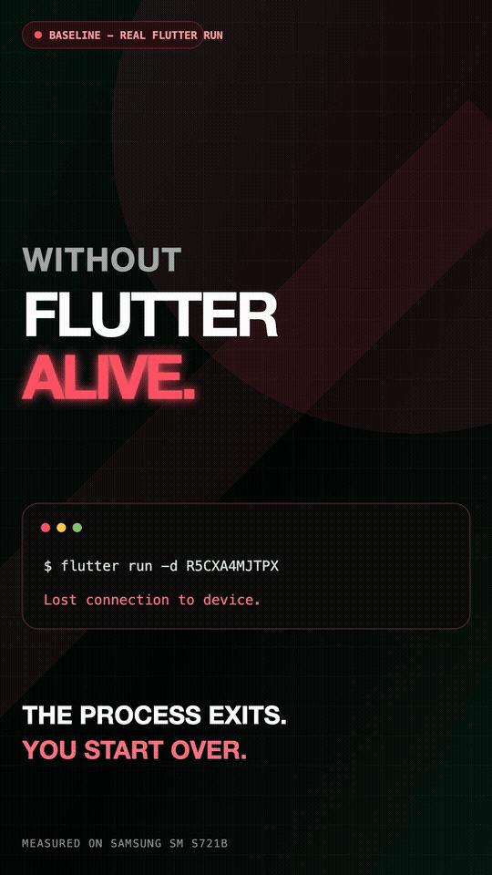
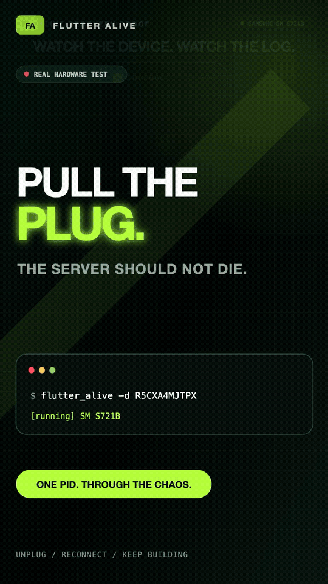
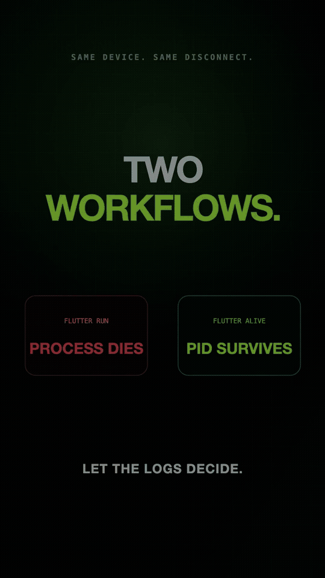

# Flutter Alive

Flutter Alive is a persistent development supervisor that keeps a Flutter CLI
workflow running when a physical device disconnects. The supervisor stays
alive, waits for the same device, then tries `flutter attach --machine` before
falling back to a fresh `flutter run --machine` session.

> Status: early alpha. The machine protocol, reconnect supervisor, Android
> USB/Wi-Fi identity matching, iOS UDID matching, diagnostics, and fake-device
> integration tests are implemented. Hardware validation is still required
> before the first stable release.

## Why This Exists

React Native's Metro process can remain available while no device is
connected. A normal `flutter run` process exits after losing its device
connection, which forces developers to start a new debug session manually.
Flutter Alive keeps a parent process resident and manages Flutter's official
machine protocols on the developer's behalf.

Flutter Alive cannot make the Dart VM Service survive a device or application
process termination. Reattaching and preserving runtime state is best effort;
when that is impossible, the tool automatically launches the app again.

## See It in Action

These demos use a physical Samsung SM S721B and a real ADB transport reset.
The console output and reconnect events are captured from actual Flutter runs,
not simulated log sequences.

### Use case 1: a normal `flutter run` exits

When the device transport disappears, the regular Flutter runner prints
`Lost connection to device.` and exits. The developer must notice the failure,
run the command again, rebuild, reinstall, and restore their debugging flow.

<p align="center">
  
</p>

The tiny warm-cache demo produced observed relaunches of 6.4 and 15.8 seconds.
Real applications can take substantially longer; these values are evidence
from the demo environment, not universal Flutter benchmarks.

### Use case 2: Flutter Alive keeps supervising

Flutter Alive keeps the same parent PID alive while the device is unavailable.
When the phone returns, it tries to attach to the existing app and falls back
to an automatic relaunch when attachment is not possible. No new
`flutter run` command is required.

<p align="center">
  
</p>

This captured run shows `running` -> `disconnected` -> `reattaching` ->
`relaunching` -> `running`, followed by a successful hot reload while the
supervisor PID remains unchanged.

### Use case 3: compare the interruption

The wall-clock recovery time varies by project, cache, platform, and whether an
existing VM Service can be reattached. The consistent difference is developer
interruption: a regular runner exits, while Flutter Alive remains available
and performs recovery without another command.

<p align="center">
  
</p>

See [demo measurement notes](doc/demo-measurements.md) and the latest
[hardware validation record](doc/validation-2026-08-24.md) for environment,
timing, and limitations.

## Quick Start

### Requirements

- Dart 3.4 or newer
- Flutter 3.22 or newer
- Android SDK platform tools for Android devices
- macOS and Xcode for physical iOS devices

### Install from this checkout

```bash
dart pub global activate --source path .
```

After the package is published:

```bash
dart pub global activate flutter_alive
```

### Run

Use the same project directory and Flutter arguments you normally use:

```bash
flutter_alive -d R5CXA4MJTPX --flavor staging -t lib/main_staging.dart
```

If the device is disconnected, Flutter Alive moves to `disconnected` and keeps
running. When the device returns, it waits 750 ms for the connection to settle,
tries to attach for 10 seconds, and relaunches if attachment is not possible.

List devices or validate the environment:

```bash
flutter_alive devices
flutter_alive doctor
```

## Commands

```text
flutter_alive [run] -d <device> [flutter run arguments...]
flutter_alive devices
flutter_alive doctor
flutter_alive init
```

Flutter Alive reserves only options prefixed with `--alive-` plus
`-d/--device-id`. Other arguments are passed to `flutter run` unchanged.

| Option | Purpose |
| --- | --- |
| `--alive-flutter=<path>` | Select a Flutter binary or SDK directory |
| `--alive-app-id=<id>` | Disambiguate Android package/iOS bundle during attach |
| `--alive-attach-timeout=<seconds>` | Override the 10-second attach timeout |
| `--alive-connection=attached\|wireless\|both` | Filter device connections |
| `--alive-config=<path>` | Load a non-default YAML config file |
| `--alive-no-attach` | Always launch a fresh app after reconnect |
| `--alive-json` | Emit JSON Lines for automation |
| `--alive-verbose` | Include Flutter daemon diagnostics |

Interactive keys are `r` reload, `R` restart, `s` status, `d` detach, Enter
retry, `c` clear, `h` help, and `q` quit.

## Configuration

`flutter_alive init` creates an optional `.flutter_alive.yaml`:

```yaml
flutter: .fvm/flutter_sdk
device: R5CXA4MJTPX
app_id: com.example.app
connection: both
attach_timeout_seconds: 10
reconnect_debounce_ms: 750
max_runner_retries: 3
runner_stability_seconds: 30
daemon_stability_seconds: 30
run_args:
  - --flavor
  - staging
```

CLI values override configuration values. CLI Flutter arguments are appended
after `run_args` and therefore keep their original Flutter CLI semantics.

## How Reconnect Works

```text
flutter_alive
├── flutter daemon                 device discovery, persistent
├── flutter run --machine          initial build and debug session
└── flutter attach --machine       first recovery attempt
          └── flutter run --machine fallback when attach cannot recover
```

- Android physical devices are matched with `ro.serialno`, so the same phone
  can move from a USB device ID to an ADB Wi-Fi address.
- iOS devices are matched by their Flutter/Xcode UDID.
- Dart and asset changes made while disconnected are synchronized after attach.
- Native or `pubspec` changes force a fresh run.
- Recoverable child failures do not terminate the parent supervisor.

See [doc/architecture.md](doc/architecture.md) for the detailed state and
protocol design.

## IDE Support

An experimental v1.1 preview is included in
`packages/flutter_alive_vscode`. It registers the `flutter_alive` debug type
and starts `flutter_alive debug-adapter`, which wraps Flutter's official DAP
adapter with a persistent outer session.

```bash
cd packages/flutter_alive_vscode
npm ci
npm run compile
npm run package
code --install-extension flutter-alive-0.1.0.vsix
```

The bridge suppresses transient `terminated`/`exited` events, waits for the
same physical device, attempts `flutter attach` first, falls back to launch,
and replays breakpoint and exception configuration. See
[doc/dap-v1.1.md](doc/dap-v1.1.md) for behavior and remaining hardware gates.

## Development

```bash
dart pub get
dart format --output=none --set-exit-if-changed .
dart analyze
dart test
dart test --coverage=coverage
```

The fake Flutter harness exercises daemon requests, device removal/addition,
runner exit, Android ID changes, and attach recovery without requiring hardware.
Physical releases must also pass
[doc/hardware-test-checklist.md](doc/hardware-test-checklist.md).
The latest Android CLI and DAP hardware evidence is recorded in
[doc/validation-2026-08-24.md](doc/validation-2026-08-24.md).
The issue-ready release backlog and project-board setup live in
[doc/github-project-plan.md](doc/github-project-plan.md).

## Project Structure

```text
bin/                         CLI entry point
lib/src/protocol/            Flutter JSON machine protocol
lib/src/daemon/              Persistent device daemon client
lib/src/runner/              run/attach machine sessions
lib/src/supervisor/          lifecycle state machine
lib/src/device/              identity and connection matching
lib/src/project/             dirty-source tracking
lib/src/cli/                 commands and argument forwarding
test/fakes/                  deterministic fake Flutter processes
doc/                         architecture and release guidance
```

## Limitations

- One project and one selected device per Flutter Alive process.
- Foreground process only; no background service commands yet.
- Wireless debugging must already be configured in Android/Xcode.
- Runtime state is preserved only when the original app and VM Service can be
  rediscovered.
- Android emulators, iOS simulators, desktop, and web are outside the v1 scope.

## Contributing and Security

Read [CONTRIBUTING.md](CONTRIBUTING.md) before opening a pull request. Report
security issues using the private process in [SECURITY.md](SECURITY.md), not a
public issue.

## License

Flutter Alive is available under the [MIT License](LICENSE).
