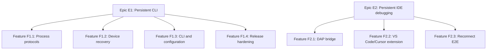

# GitHub Project Plan

## Project Overview

Flutter Alive keeps a foreground Flutter development workflow alive across
physical-device disconnects. The critical path is a reliable CLI supervisor,
followed by hardware hardening and a persistent DAP bridge for editors.

Success criteria:

- The supervisor PID remains unchanged during a five-minute disconnect.
- Reconnect performs attach-first recovery and falls back to a cold run.
- Build failures wait for user input or source changes instead of looping.
- Android and iOS hardware checklists pass before v1.0.
- Core library coverage reaches 85% before v1.0.
- A v1.1 editor debug session survives VM Service replacement and replays
  breakpoints.

## Work Item Hierarchy

## Issue Backlog

| ID | Type | Title | Priority | Release | Estimate | Blocked by | Labels |
| --- | --- | --- | --- | --- | --- | --- | --- |
| E1 | Epic | Persistent Flutter CLI supervisor | P0 | v1.0 | XL | - | `epic`, `component-supervisor` |
| F1.1 | Feature | Official Flutter machine protocol clients | P0 | v0.1 | M | - | `feature`, `component-protocol` |
| EN1.1 | Enabler | Correlated JSON machine connection | P0 | v0.1 | 5 | F1.1 | `enabler`, `component-protocol` |
| T1.1 | Test | Malformed framing, request correlation, and process exit | P0 | v0.1 | 3 | EN1.1 | `test`, `component-protocol` |
| F1.2 | Feature | Physical-device disconnect recovery | P0 | v0.5 | L | F1.1 | `feature`, `component-supervisor` |
| S1.2 | Story | Keep parent alive while target is absent | P0 | v0.1 | 5 | F1.1 | `user-story`, `platform-android` |
| S1.3 | Story | Attach first and relaunch on failure | P0 | v0.5 | 5 | S1.2 | `user-story`, `component-runner` |
| EN1.2 | Enabler | Stable Android USB/Wi-Fi identity | P0 | v0.5 | 3 | S1.2 | `enabler`, `platform-android` |
| EN1.3 | Enabler | iOS UDID reconnect support | P0 | v0.5 | 5 | S1.2 | `enabler`, `platform-ios` |
| T1.2 | Test | Fake daemon/runner recovery matrix | P0 | v0.5 | 5 | S1.3 | `test`, `component-supervisor` |
| T1.3 | Test | Android and iOS physical-device checklist | P0 | v1.0 | 8 | EN1.2, EN1.3 | `test`, `platform-hardware` |
| F1.3 | Feature | Public CLI, YAML config, doctor, and JSON events | P1 | v0.5 | M | F1.1 | `feature`, `component-cli` |
| S1.4 | Story | Forward normal Flutter run arguments unchanged | P0 | v0.1 | 3 | F1.3 | `user-story`, `component-cli` |
| S1.5 | Story | Operate interactively and through JSON Lines | P1 | v0.5 | 5 | F1.3 | `user-story`, `component-cli` |
| T1.4 | Test | Config precedence and Flutter compatibility | P0 | v0.5 | 3 | S1.4 | `test`, `component-cli` |
| F1.4 | Feature | Cross-platform release hardening | P0 | v1.0 | L | F1.2, F1.3 | `feature`, `component-release` |
| EN1.4 | Enabler | CI, trusted publishing, binaries, and checksums | P1 | v1.0 | 5 | F1.4 | `enabler`, `component-ci` |
| EN1.5 | Enabler | Security and orphan-process review | P0 | v1.0 | 5 | F1.4 | `enabler`, `security` |
| T1.5 | Test | Raise core coverage to 85% | P1 | v1.0 | 8 | F1.4 | `test`, `component-testing` |
| E2 | Epic | Persistent IDE debugging | P1 | v1.1 | XL | E1 | `epic`, `component-dap` |
| F2.1 | Feature | Long-lived DAP bridge | P1 | v1.1 | L | E1 | `feature`, `component-dap` |
| EN2.1 | Enabler | Child Flutter adapter lifecycle and message proxy | P1 | v1.1 | 8 | F2.1 | `enabler`, `component-dap` |
| S2.1 | Story | Suppress transient termination during reconnect | P1 | v1.1 | 5 | EN2.1 | `user-story`, `component-dap` |
| S2.2 | Story | Replay breakpoints and debugger configuration | P1 | v1.1 | 8 | EN2.1 | `user-story`, `component-dap` |
| F2.2 | Feature | VS Code/Cursor debug extension | P1 | v1.1 | M | F2.1 | `feature`, `component-vscode` |
| S2.3 | Story | Migrate Dart launch configurations | P2 | v1.1 | 3 | F2.2 | `user-story`, `component-vscode` |
| F2.3 | Feature | Persistent-debug E2E validation | P1 | v1.1 | M | F2.1, F2.2 | `feature`, `component-testing` |
| T2.1 | Test | Same DAP session and breakpoint hit after reconnect | P1 | v1.1 | 8 | F2.3 | `test`, `component-dap` |

## Critical Acceptance Criteria

### E1: Persistent Flutter CLI Supervisor

- [ ] `flutter_alive run` survives daemon, runner, and device loss.
- [ ] Only explicit shutdown or unrecoverable startup validation ends the parent.
- [ ] Commands use executable/argument lists without shell interpolation.
- [ ] Android/iOS hardware validation and release quality gates pass.

### F1.2: Physical-Device Disconnect Recovery

- [ ] Target identity survives Android USB-to-Wi-Fi ID changes.
- [ ] Reconnect is debounced and tries attach within the configured timeout.
- [ ] Hot changes reload after attach; cold changes skip attach.
- [ ] Attach failure or timeout launches a fresh app exactly once.
- [ ] Rapid crashes stop at the configured retry ceiling.

### E2: Persistent IDE Debugging

- [ ] The outer DAP session does not emit terminal events for transient loss.
- [ ] A replacement child adapter connects to the new VM Service.
- [ ] Breakpoints, exception settings, and source mappings are restored before
  resume.
- [ ] Existing Dart launch configurations can be migrated without losing their
  familiar fields.

## Definition of Ready

- Acceptance criteria are observable and testable.
- Dependencies and target release are assigned.
- Platform and component labels are present.
- Hardware work names the required host, device, and connection modes.

## Definition of Done

- Format, fatal analysis, unit/integration tests, and package dry-run pass.
- New behavior has automated tests or an explicit hardware checklist result.
- Documentation, limitations, and changelog are updated.
- No secrets, environment values, or full Dart defines appear in logs.
- Child processes and terminal state are clean after shutdown.

## Project Configuration

Use statuses `Backlog`, `Ready`, `In Progress`, `Review`, `Testing`, and `Done`.
Add fields for `Priority`, `Release`, `Component`, `Platform`, `Estimate`, and
`Parent`. Use milestones `v0.1`, `v0.5`, `v1.0`, and `v1.1`.

Recommended labels:

- Type: `epic`, `feature`, `user-story`, `enabler`, `test`, `bug`.
- Priority: `priority-p0`, `priority-p1`, `priority-p2`, `priority-p3`.
- Platform: `platform-android`, `platform-ios`, `platform-macos`,
  `platform-linux`, `platform-windows`, `platform-hardware`.
- Component: `component-cli`, `component-protocol`, `component-daemon`,
  `component-runner`, `component-supervisor`, `component-dap`,
  `component-vscode`, `component-ci`, `component-testing`.

## Risks

| Risk | Impact | Mitigation |
| --- | --- | --- |
| Flutter machine protocol changes | Recovery breaks on new Flutter releases | Warn on protocol mismatch and run compatibility CI/manual checks |
| VM Service dies with the app | Runtime state cannot be preserved | Document best-effort semantics and cold-run fallback |
| Hardware identity is ambiguous | Wrong same-model device may be selected | Prefer hardware serial/UDID, then exact ID, then constrained metadata |
| Editor emits termination early | v1.1 debug session still ends | Keep a long-lived outer DAP adapter and suppress only transient termination |
| OS process differences | Orphan children or broken terminal state | Cross-platform CI plus manual shutdown checklist |
